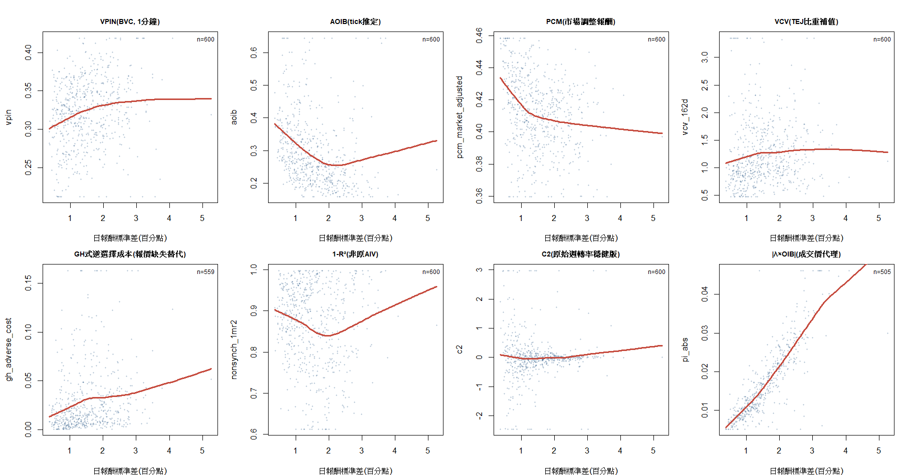
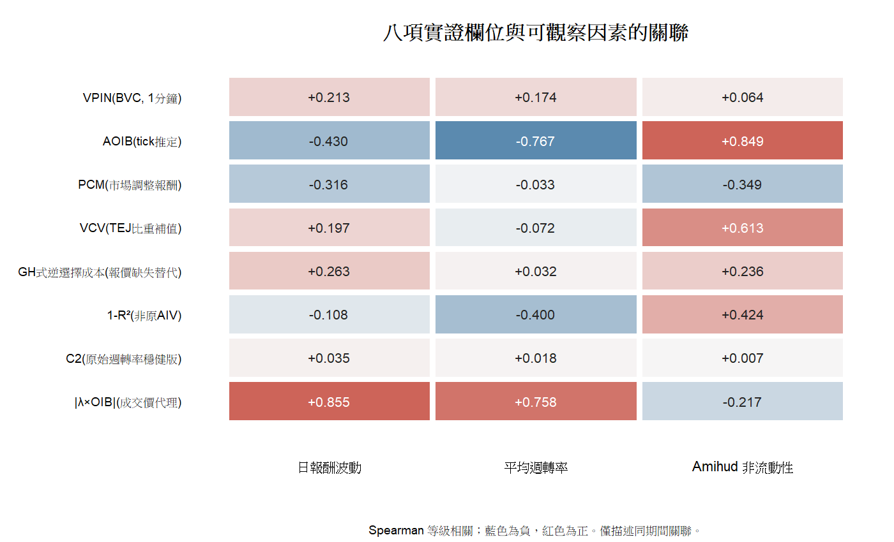
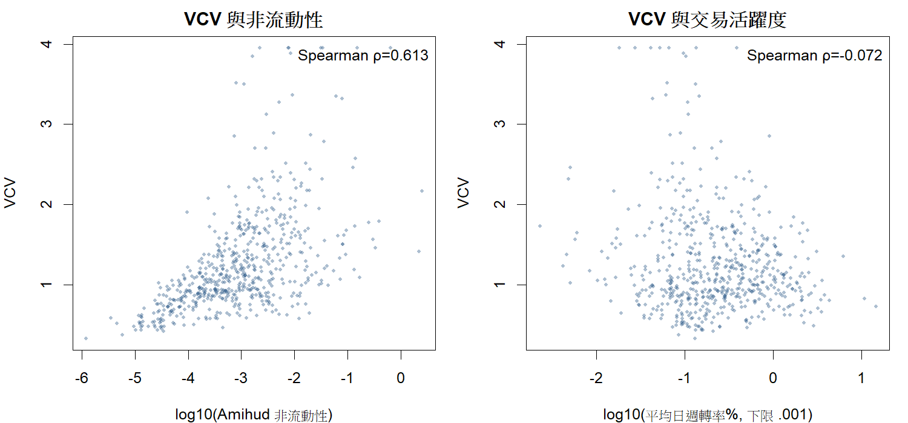

# HW3：Q1–Q4（繁體中文）

資料期間為 2019/04/09–11/29。600 檔股票從日資料完整、三個日內檔皆有紀錄的 893 檔中，依期初市值排序等距選取，以符合本題涵蓋不同公司規模的要求。2019 年盤中屬集合競價；以下由 tick test 推定的是撮合回合的買賣壓力，不是連續競價下可直接觀察的主動方。

## Q1. 八項指標與評估

| 指標 | 文獻定義與適用範圍 |
|---|---|
| PIN／VPIN（合計一項） | PIN = αμ/(αμ+ε_b+ε_s) 是交易到達模型內的知情交易機率；VPIN 是固定成交量桶內買賣量不平衡的移動平均，適合日內監測成交流毒性。[Easley et al. 1996](https://doi.org/10.1111/j.1540-6261.1996.tb04074.x)、[Easley et al. 2012](https://doi.org/10.1093/rfs/hhs053)。Q3 依題意使用 VPIN。 |
| AOIB | 買賣成交筆數的絕對差除以可判方向的總筆數；有與實際內線交易對照的驗證，但一般流動性需求亦會造成失衡。[Ahern 2020](https://doi.org/10.1093/rapstu/raaa004)。 |
| PCM | 1,000–9,999 股中型逆勢交易筆數占當日全部交易筆數；逆勢依非預期日報酬與交易方向判定。[Chang & Wang 2019](https://doi.org/10.1016/j.finmar.2018.08.002)。 |
| VCV | 每日交易量的標準差除以平均值。在作者模型中隨知情交易比例上升；不需判斷交易方向。[Lof & van Bommel 2023](https://doi.org/10.1016/j.jcorpfin.2023.102464)。 |
| QID residual | 由最佳報價改善與成交驅動報價惡化的計數差比率，扣除由價差預測的水準，按先前波動標準化後反向，反映流動性提供者對逆選擇風險的反應。[Barardehi et al. 2026](https://doi.org/10.1111/jofi.70047)。本資料沒有逐次報價，原法不能估計。 |
| AIV | 資訊事件前的特有波動超過正常時期的部分。[Yang, Zhang & Zhang 2020](https://doi.org/10.1016/j.jfineco.2019.06.013)。新補的第 2 季合併季報公告檔僅涵蓋本樣本 569 檔；第 3 題既有實證欄位仍是另列的價格非同步性代理，不能稱為原法 AIV。 |
| Llorente C₂ | 估計次日報酬對當日報酬及「當日報酬×成交量」的迴歸，C₂ 越高通常表示資訊性交易相對風險分攤交易越重要。[Llorente et al. 2002](https://web.mit.edu/wangj/Public/Publication/Llorente-Michaely-Saar-Wang02.pdf)。 |
| λ×OIB | 將預期價格衝擊乘以帶方向的成交失衡，以策略交易模型推論私人資訊訊號。[Bongaerts, Rösch & van Dijk 2026](https://doi.org/10.1093/rapstu/raaf009)。原文用報價中價估 λ，本資料只有成交價格。 |

八項並非相同概念，不能把每個數值都當成知情交易的百分比。若重視模型內機率，PIN 的意義最明確；若需盤中變動，VPIN 較適合；若需在本批集合競價資料比較 600 檔，VCV 不依賴方向推定，資料適用性較好。AOIB 有直接驗證證據，但易與非資訊性失衡混淆。選擇「最好」的代理應看事件辨識力、跨方法一致性及對流動性控制的穩健性，而不能只看公式名稱。[Ahern 2020](https://doi.org/10.1093/rapstu/raaa004)、[Lof & van Bommel 2023](https://doi.org/10.1016/j.jcorpfin.2023.102464)。

## Q2. 哪些因素影響知情交易？

依 PIN 模型，資訊事件機率 α 和知情交易到達率 μ 上升會提高 PIN；非知情買、賣到達率 ε_b、ε_s 上升則降低知情交易在所有交易中的占比。總成交量同時包含兩類交易，因此其效果沒有固定方向。[Easley et al. 1996](https://doi.org/10.1111/j.1540-6261.1996.tb04074.x)。

| 因素 | 預期機制 | 本資料可觀察的對應 |
|---|---|---|
| 公司規模 | 小公司可能較少公開資訊，私人資訊價值較高；但關聯不等於因果。[Bongaerts et al. 2026](https://doi.org/10.1093/rapstu/raaf009)。 | 期初市值及其對數。 |
| 資訊事件及揭露 | 公告前資訊分布可能更不均；公開後差距可能收斂。[Yang et al. 2020](https://doi.org/10.1016/j.jfineco.2019.06.013)、[Chang & Wang 2019](https://doi.org/10.1016/j.finmar.2018.08.002)。 | 新補 TEJ 第 2 季合併季報公告日期可供 569 檔做第 6 題事件研究；不可事後挑高波動日充當事件。 |
| 非知情交易與市場深度 | 噪音交易可掩護知情交易，也增加承接量；總成交量的符號不固定。[Kyle 1985](https://people.stern.nyu.edu/lpederse/courses/LAP/papers/Information%2CFundamental/Kyle85.pdf)。 | 成交量、成交值、週轉率及筆數。 |
| 風險與不確定性 | 特有波動可能反映私人資訊，也可能由公開消息引起。[Yang et al. 2020](https://doi.org/10.1016/j.jfineco.2019.06.013)。 | 日報酬波動與公司特有報酬成分。 |
| 資訊生產與投資人結構 | 分析師、揭露品質及機構投資人會改變資訊分布；機構參與的方向不預設。[Brennan & Subrahmanyam 1995](https://doi.org/10.1016/0304-405X(94)00811-E)、[Easley & O'Hara 2004](https://doi.org/10.1111/j.1540-6261.2004.00672.x)。 | 本資料無分析師追蹤或持股比率；日內 InvestType 是成交類型，不是持股。 |

因此 Q3 以交易活躍度與報酬波動呈現資料關係；公司規模只用於滿足抽樣要求，不作為 Q3 圖表的分層或橫軸。缺少的分析師與持股資料不會被寫成已控制變數。

## Q3. 600 檔實證

### 資料、樣本及方法

TEJ 日資料涵蓋 2019/04/09–11/29 共 162 個交易日、951 個股票代碼；日內三檔共有約 2.70 億筆原始紀錄。先要求日資料全期完整、三段日內檔均有交易、股票代碼為四位數，再依 2019/04/09 市值排序等距選出 600 檔。此抽樣涵蓋不同規模，但因日內可用性篩選，並非全體上市股票的隨機樣本。[最終樣本名單](results/sample_600_final.csv)。

依[日內資料處理附檔](資料處理以及交易方向判斷注意事項.pdf)，逐筆 `BuySell` 表示成交紀錄的買賣側，不是積極買賣方；同一 `TrdNo` 若兩側都有紀錄，保留買側作為該筆成交，並核對兩側股數。方向由同一撮合回合（時間、價格）的 tick test 推定；每日首回合無前價，記為方向不明。僅保留一般盤中交易碼與交易時段。兩側成交股數核對結果為零筆不一致。以 2330 在 2019/10/17 為人工抽核例，去重後 13,822 筆成交、2,892 個撮合回合、327 筆方向不明；批次 AOIB 為 0.3485，與單日試算一致。這些方向推定會影響 AOIB、PCM、GH 式成本及 λ×OIB；VPIN 則使用成交價變化的 BVC 分類，不使用 `BuySell` 作積極方。

八個實證欄位的具體作法如下。**原法不可計算者保留原名作文獻比較，實證欄位另標為代理；兩者不是等價估計。**

1. **VPIN**：由一分鐘最後成交價與成交股數建立 BVC 買賣量，固定桶量為該股最初 20 個 TEJ 日的平均日成交股數除以 50；每 50 桶移動平均絕對量差比例，再將桶值按交易日取平均。每個原始日內檔重新開始累積桶，期初約 20 日僅供校準，不進入正式 VPIN。TEJ 日量包含的交易類型可能與篩選後一般盤中成交略異，且跨檔重置使邊界附近數值不是完全連續的原法 VPIN。
2. **AOIB**：每日 $|N_B-N_S|/(N_B+N_S)$，其中 $N_B,N_S$ 是可判方向的成交筆數；公司值為每日等權平均。方向不明交易不進分子、分母。
3. **PCM**：1,000–9,999 股且方向與當日「個股報酬減當日 TEJ 股票等權平均報酬」相反的成交筆數，除以當日**可判方向**的一般盤中成交筆數，再對日期等權平均。依資料處理附檔，每日第一次撮合不跨日判方向，故分母也排除這些成交；此分母處理與原文所有可分類成交的定義有差異。此處以市場調整報酬代理文獻的非預期報酬；原文的美股中型交易門檻未必適合台股一張 1,000 股的制度。
4. **VCV**：使用新補的 TEJ「成交值比重％」逐日欄位，計算 162 日標準差／平均值。原欄位的 `.` 為缺值；另有成交值為正但比重四捨五入為 0.000% 的紀錄。以同日比重至少 0.05% 的股票反推總成交值分母，取其中位數，對缺值與被四捨五入的零值按原始成交值補回比重；[逐日檔](results/vcv_daily_share.csv)保留原欄位、補後比重與補值旗標。主要結果標為**TEJ 比重補值版**。只用 TEJ 原欄位、不補值的 VCV 另列為敏感度結果，至少需要 30 個非缺值交易日且平均比重大於零；它與補值版的觀察天數可能不同。[公司層級 VCV 明細](results/vcv_period.csv)列示兩版。[Lof & van Bommel 2023](https://doi.org/10.1016/j.jcorpfin.2023.102464) 的市占率採成交值比重。
5. **GH 式逆選擇成本**：因無最佳買賣報價，不能計算 QID residual。改以撮合回合價變動對方向及方向×回合股數估計 Glosten–Harris 式係數，按該股當日回合股數中位數換算每股逆選擇成本（新台幣）。此為**另一種成交價式逆選擇代理，不是 QID residual**；小樣本或係數不可識別的交易日保留缺值。方向與價變同由成交價推定，可能有機械性相關，不能視為乾淨的價差分解。[Glosten & Harris 1988](https://www.acsu.buffalo.edu/~keechung/MGF743/Readings/B3%20Glosten%20and%20Harris%2C%201988%20JFE.pdf)。
6. **價格非同步性 $1-R^2$**：第 3 題既有估計使用 162 日日報酬對 TEJ 股票等權市場報酬的一因子迴歸，取得 $1-R^2$ 作特有價格變動代理。新補的第 2 季公告檔有 569 檔事件日期，但未回溯重估此欄；它仍會受雜訊、低流動性與市場模型選擇影響，**不能稱為原文 AIV**。[Durnev et al. 2003](https://pages.stern.nyu.edu/~byeung/greater.pdf)。
7. **C₂**：逐股估計 $r_{i,t+1}=C_{0i}+C_{1i}r_{i,t}+C_{2i}r_{i,t}Turnover_{i,t}+\varepsilon_{i,t+1}$。僅有 162 日，不足以在全期估原文主要版本的 200 日移動趨勢，故用作者第 3.4 節的原始週轉率穩健版本；週轉率單位為百分點，係數不能直接與其他尺度比較。
8. **成交價式 $|\lambda\times OIB|$**：以相鄰五分鐘最後成交價對數變動迴歸該五分鐘帶方向成交值（百萬新台幣），先求每日 $\lambda$；負值設零，取此前最多 20 個交易日、至少 10 個有效日的平均，並於當日橫斷面以上側 95 百分位截尾。再乘當日帶方向成交值並取絕對值，逐股對交易日等權平均。原文使用報價中價與美元成交值，這裡是**成交價代理**，不當成原估計量。

上述 VPIN 的桶值計算式為 $VPIN_b=50^{-1}\sum_{k=b-49}^{b}|V_k^B-V_k^S|/V_{bucket}$；BVC 在每個一分鐘時間棒以 $V^B=V\Phi(\Delta P/\sigma_{\Delta P})$ 分配買量，其餘為賣量，$\sigma_{\Delta P}$ 由此前 20 個一分鐘價格變動估計。每交易日首個時間棒的價變不跨日計算。這是由價格變化推定的量分類，不是直接觀察交易者資訊。C₂、VCV 及 $1-R^2$ 為期間公司層級值，其餘先算每日、再取公司日等權平均。

### 結果與圖表

三段日內檔合計 96,637 個股票交易日，涵蓋 600 檔；各股有一般盤中成交的交易日數最少 89 日、中位數 162 日。買賣兩側股數核對無不一致。每日首個無法判方向回合佔各公司成交筆數的中位數為 3.50%。VPIN 自校準期後有 82,720 個股票交易日（2019/05/08–11/29），600 檔皆有結果。其餘指標的缺值按各方法最低可估條件保留，沒有填零。

| 實證指標 | 有效股票數 | 平均 | 第 5 百分位 | 中位數 | 第 95 百分位 |
|---|---:|---:|---:|---:|---:|
| VPIN，BVC 版 | 600 | 0.323 | 0.245 | 0.325 | 0.392 |
| AOIB，tick 推定 | 600 | 0.297 | 0.172 | 0.268 | 0.519 |
| PCM，市場調整報酬版 | 600 | 0.412 | 0.370 | 0.414 | 0.451 |
| VCV，TEJ 成交值比重補值版 | 600 | 1.286 | 0.556 | 1.082 | 2.342 |
| GH 式逆選擇成本，非 QID，元／股 | 559 | 0.0309 | 0.0021 | 0.0172 | 0.1014 |
| $1-R^2$，非 AIV | 600 | 0.864 | 0.664 | 0.885 | 0.993 |
| C₂，原始週轉率版 | 600 | −0.0968 | −1.241 | −0.0192 | 1.228 |
| $|\lambda\times OIB|$，成交價版 | 505 | 0.0174 | 0.0065 | 0.0149 | 0.0351 |

上表 VPIN、AOIB、PCM 等是**指標值**，不能解讀為「真實知情交易機率為 32.3%、29.7% 或 41.2%」。各欄位單位與建構方式不同，也不能比較平均值大小。GH 式成本僅 559 檔、成交價版 $|\lambda\times OIB|$ 僅 505 檔可穩定估計；缺值組的週轉率較低，跨指標比較有樣本選擇問題。完整數值與有效樣本數見 [描述統計表](results/q3_descriptive_stats.csv)。

新 TEJ 比重欄位與原日資料的 153,110 個股票日期完全對應。全檔有 8,808 個 `.` 缺值，以及 12,654 個「成交值為正、比重顯示 0.000%」的紀錄；600 檔樣本內分別為 1,895 與 8,115 個。每日由可觀察比重反推的分母，其四分位距／中位數的跨股中位數為 0.24%，故以每日中位分母補值。只用 TEJ 原欄位至少 30 日且平均比重大於零者可估 592 檔；補值後可估 600 檔。兩版在共同 592 檔的 Spearman 等級相關為 0.970。補值仍依賴同日分母一致的假設，尤其影響極低成交值股票。

圖中橫軸是公司日報酬標準差，紅線是平滑趨勢；縱軸將各指標最低與最高 2% 壓至第 2、98 百分位供視覺呈現，統計表及相關係數仍使用原值。以 Spearman 等級相關衡量，成交價版 $|\lambda\times OIB|$ 與報酬波動為 +0.855，VPIN 為 +0.213，VCV 為 +0.197，PCM 為 −0.316，C₂ 則僅 +0.035。前者可能同時反映一般價格波動與成交衝擊，不能直接稱為私人資訊訊號。PCM 的原文 1,000–9,999 股門檻在台股一張 1,000 股的制度下未必有相同意義；C₂ 分布兩端也有大幅極值。完整關聯見 [交易特徵關聯表](results/q3_associations.csv)。

第二圖以 Spearman 等級相關，將八項實證欄位與 Q2 討論的可觀察面向對照：日報酬波動代表價格風險，平均週轉率代表交易活躍度，Amihud 非流動性代表流動性條件。AOIB 與非流動性為 +0.849、與週轉率為 −0.767；成交價版 $|\lambda\times OIB|$ 與波動及週轉率分別為 +0.855、+0.758，可能混合了流動性、一般價格波動與成交衝擊。VCV 與非流動性為 +0.613，PCM 與週轉率則僅 −0.033。部分欄位與比較因素共享價格或交易量輸入，相關性可能含機械關聯。兩圖均為橫斷面描述，**不能據此判定哪項最能辨識私人資訊、因果效果或真實知情交易機率**。

## Q4. 流動性與資訊不對稱

資訊不對稱造成逆向選擇：流動性提供者不知道交易對手是否掌握私人資訊。以競爭性、風險中立報價者的簡化式表示：

$$
Ask_t=E[v\mid Buy,\mathcal I_t]+c_t,\qquad
Bid_t=E[v\mid Sell,\mathcal I_t]-c_t.
$$

因此

$$
Spread_t=\underbrace{E[v\mid Buy,\mathcal I_t]-E[v\mid Sell,\mathcal I_t]}_{\text{逆向選擇成分}}
+\underbrace{2c_t}_{\text{非資訊成本}}.
$$

第一項是資訊性的逆向選擇成分，第二項概括處理及存貨等非資訊成本。知情買單更可能在價值偏高時到達，故資訊風險上升通常擴大價差、降低流動性。此式表達 [Glosten & Milgrom (1985)](https://pages.stern.nyu.edu/~lpederse/courses/LAP/papers/Information%2CFundamental/GlostenMilgrom85.pdf) 的核心邏輯，並非完整均衡式。

以價格衝擊看，Kyle 式可概括為

$$
\Delta P_t=\lambda_t Q_t+u_t,\qquad Depth_t\propto 1/\lambda_t.
$$

其中 $Q_t$ 是帶方向的淨成交量，$\lambda_t$ 是每單位淨成交的價格反應。同量交易造成更大的價格變化代表較低深度。[Kyle 1985](https://people.stern.nyu.edu/lpederse/courses/LAP/papers/Information%2CFundamental/Kyle85.pdf)。資訊風險可能提高 $\lambda$，但流動性、波動及市場制度也會影響它，故一般價格衝擊不能單獨等同知情交易。

本批檔案沒有最佳買賣報價，因此不能直接估 quoted spread 或有效價差的逆向選擇分解。實證比較使用本次 HW3 日資料重新計算的 Amihud 非流動性

$$
ILLIQ_i=\frac{1}{T_i}\sum_{t:Value_{it}>0}\frac{|r_{it}|}{Value_{it}},
$$

其中 $T_i$ 是該股成交值為正的交易日數，報酬用小數、成交值用百萬新台幣，並另以平均日週轉率表示交易活躍度。零成交值日不進 Amihud 分母；此為流動性代理，並非知情交易的直接觀察。[Amihud 2002](https://doi.org/10.1016/S1386-4181(01)00024-6)。

在這 600 檔中，TEJ 比重補值版 VCV 與 Amihud 的 Spearman 等級相關為 **+0.613**，與週轉率則為 **−0.072**。只用 TEJ 原欄位可估的 592 檔，VCV 與 Amihud 的相關為 **+0.694**；在同一 592 檔上使用補值版則為 **+0.609**。補值會改變相關強度，故須呈現兩版。圖中 VCV 高於第 99 百分位的點壓至該界線供閱讀，相關係數使用原值。這與逆向選擇可能惡化流動性的模型方向一致，但兩指標都使用成交值，可能有機械性共變；波動與交易不連續也可能同時造成兩者升高。因此不能據此估計資訊風險對流動性的因果效果；週轉率相關接近零亦顯示不同流動性代理並不相同。

## 參考文獻

- Ahern, K. R. (2020). [Do Proxies for Informed Trading Measure Informed Trading? Evidence from Illegal Insider Trades](https://doi.org/10.1093/rapstu/raaa004). *Review of Asset Pricing Studies*.
- Amihud, Y. (2002). [Illiquidity and stock returns: cross-section and time-series effects](https://doi.org/10.1016/S1386-4181(01)00024-6). *Journal of Financial Markets*.
- Barardehi et al. (2026). [Detecting Informed Trading Risk from Undercutting Activity](https://doi.org/10.1111/jofi.70047). *Journal of Finance*.
- Bongaerts, D., Rösch, D., & van Dijk, M. (2026). [Cross-Sectional Identification of Private Information](https://doi.org/10.1093/rapstu/raaf009). *Review of Asset Pricing Studies*.
- Brennan, M. J., & Subrahmanyam, A. (1995). [Investment analysis and price formation in securities markets](https://doi.org/10.1016/0304-405X(94)00811-E). *Journal of Financial Economics*.
- Chang & Wang (2019). [Informed contrarian trades and stock returns](https://doi.org/10.1016/j.finmar.2018.08.002). *Journal of Financial Markets*.
- Durnev, A., Morck, R., Yeung, B., & Zarowin, P. (2003). [Does greater firm-specific return variation mean more or less informed stock pricing?](https://doi.org/10.1046/j.1475-679X.2003.00124.x). *Journal of Accounting Research*.
- Easley, D., Kiefer, N. M., O'Hara, M., & Paperman, J. B. (1996). [Liquidity, Information, and Infrequently Traded Stocks](https://doi.org/10.1111/j.1540-6261.1996.tb04074.x). *Journal of Finance*.
- Easley, D., & O'Hara, M. (2004). [Information and the Cost of Capital](https://doi.org/10.1111/j.1540-6261.2004.00672.x). *Journal of Finance*.
- Easley, D., López de Prado, M., & O'Hara, M. (2012). [Flow Toxicity and Liquidity in a High Frequency World](https://doi.org/10.1093/rfs/hhs053). *Review of Financial Studies*.
- Glosten, L. R., & Harris, L. E. (1988). [Estimating the Components of the Bid/Ask Spread](https://www.acsu.buffalo.edu/~keechung/MGF743/Readings/B3%20Glosten%20and%20Harris%2C%201988%20JFE.pdf). *Journal of Financial Economics*.
- Glosten, L. R., & Milgrom, P. R. (1985). [Bid, ask and transaction prices in a specialist market with heterogeneously informed traders](https://pages.stern.nyu.edu/~lpederse/courses/LAP/papers/Information%2CFundamental/GlostenMilgrom85.pdf). *Journal of Financial Economics*.
- Kyle, A. S. (1985). [Continuous auctions and insider trading](https://people.stern.nyu.edu/lpederse/courses/LAP/papers/Information%2CFundamental/Kyle85.pdf). *Econometrica*.
- Llorente, G., Michaely, R., Saar, G., & Wang, J. (2002). [Dynamic Volume-Return Relation of Individual Stocks](https://web.mit.edu/wangj/Public/Publication/Llorente-Michaely-Saar-Wang02.pdf). *Review of Financial Studies*.
- Lof, M., & van Bommel, J. (2023). [Asymmetric information and the distribution of trading volume](https://doi.org/10.1016/j.jcorpfin.2023.102464). *Journal of Corporate Finance*.
- Yang, Y. C., Zhang, B., & Zhang, C. (2020). [Is information risk priced? Evidence from abnormal idiosyncratic volatility](https://doi.org/10.1016/j.jfineco.2019.06.013). *Journal of Financial Economics*.
