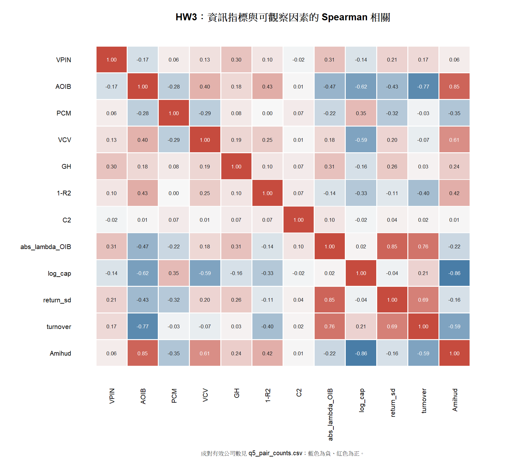

# HW3 第 5 題：相關矩陣

本題沿用 [Q1–Q4 的 600 檔 HW3 樣本與估計定義](HW3_Q1_Q4.md)。前八欄是第 3 題的八項**實證欄位**，其中 GH 式成本是 QID residual 的替代指標，\(1-R^2\) 是 AIV 的替代指標，\(|\lambda\times OIB|\) 是成交價版代理；它們不是原文估計量。後四欄是第 2、4 題在本次 HW3 日資料中可觀察的因素：公司規模、報酬波動、週轉率與 Amihud 非流動性。公司規模直接取本次 TEJ「市值(百萬元)」，只以對數作矩陣顯示，沒有沿用上次作業的分層或估計結果。分析師與機構持股在目前檔案中沒有可用欄位；新補的公告日期用於第 6 題事件研究，屬事件時間而非此公司層級全期相關矩陣的連續變數。

令 \(X_i\) 為公司 \(i\) 的全期指標或公司日指標平均；表中 \(\rho_{jk}=\operatorname{Corr}(\operatorname{rank}(X_{ij}),\operatorname{rank}(X_{ik}))\) 為**公司橫斷面的 Spearman 等級相關**。選用等級相關是因為各指標尺度不同，且 C₂、Amihud 等有明顯極值。每一對使用雙方皆有有效估計的公司；因此矩陣各格樣本數不同。

| 變數 | VPIN | AOIB | PCM | VCV | GH | 1-R2 | C2 | abs_lambda_OIB | log_cap | return_sd | turnover | Amihud |
|---|---:|---:|---:|---:|---:|---:|---:|---:|---:|---:|---:|---:|
| VPIN | +1.00 | -0.17 | +0.06 | +0.13 | +0.30 | +0.10 | -0.02 | +0.31 | -0.14 | +0.21 | +0.17 | +0.06 |
| AOIB | -0.17 | +1.00 | -0.28 | +0.40 | +0.18 | +0.43 | +0.01 | -0.47 | -0.62 | -0.43 | -0.77 | +0.85 |
| PCM | +0.06 | -0.28 | +1.00 | -0.29 | +0.08 | +0.00 | +0.07 | -0.22 | +0.35 | -0.32 | -0.03 | -0.35 |
| VCV | +0.13 | +0.40 | -0.29 | +1.00 | +0.19 | +0.25 | +0.01 | +0.18 | -0.59 | +0.20 | -0.07 | +0.61 |
| GH | +0.30 | +0.18 | +0.08 | +0.19 | +1.00 | +0.10 | +0.07 | +0.31 | -0.16 | +0.26 | +0.03 | +0.24 |
| 1-R2 | +0.10 | +0.43 | +0.00 | +0.25 | +0.10 | +1.00 | +0.07 | -0.14 | -0.33 | -0.11 | -0.40 | +0.42 |
| C2 | -0.02 | +0.01 | +0.07 | +0.01 | +0.07 | +0.07 | +1.00 | +0.10 | -0.02 | +0.04 | +0.02 | +0.01 |
| abs_lambda_OIB | +0.31 | -0.47 | -0.22 | +0.18 | +0.31 | -0.14 | +0.10 | +1.00 | +0.02 | +0.85 | +0.76 | -0.22 |
| log_cap | -0.14 | -0.62 | +0.35 | -0.59 | -0.16 | -0.33 | -0.02 | +0.02 | +1.00 | -0.04 | +0.21 | -0.86 |
| return_sd | +0.21 | -0.43 | -0.32 | +0.20 | +0.26 | -0.11 | +0.04 | +0.85 | -0.04 | +1.00 | +0.69 | -0.16 |
| turnover | +0.17 | -0.77 | -0.03 | -0.07 | +0.03 | -0.40 | +0.02 | +0.76 | +0.21 | +0.69 | +1.00 | -0.59 |
| Amihud | +0.06 | +0.85 | -0.35 | +0.61 | +0.24 | +0.42 | +0.01 | -0.22 | -0.86 | -0.16 | -0.59 | +1.00 |

欄名：\(1-R2\) 表示 \(1-R^2\)；\(abs\_lambda\_OIB\) 表示 \(|\lambda\times OIB|\)；\(log\_cap\) 是市值的自然對數；\(return\_sd\) 是日報酬標準差；\(turnover\) 是平均日週轉率。完整精度見 [相關係數 CSV](results/q5_spearman_matrix.csv)，逐格樣本數見 [配對樣本數 CSV](results/q5_pair_counts.csv)。GH 相關格有 559 檔，成交價版 \(|\lambda\times OIB|\) 相關格有 505 檔，其餘兩兩相關為 600 檔；包含全部 12 欄的完整樣本為 505 檔。

### 主要發現

1. **指標之間沒有一致的共同排序。** VPIN 與 VCV 為 +0.127、與 AOIB 為 −0.171；AOIB 與 VCV 為 +0.404，但與 PCM 為 −0.283、與成交價版 \(|\lambda\times OIB|\) 為 −0.473。GH 式成本與 VPIN、成交價版 \(|\lambda\times OIB|\) 分別約 +0.304、+0.315。這些指標可能涵蓋不同交易訊號，且估計輸入與有效日期不同；低相關不能單獨判定哪個「錯」或哪個最接近真實 PIN。
2. **流動性與交易活躍度混在部分指標中。** AOIB 與 Amihud 非流動性為 +0.849，與週轉率為 −0.767；VCV 與 Amihud 為 +0.613。小型公司在本樣本也往往較不流動：\(log\_cap\) 與 Amihud 為 −0.855。這些關係提示後續事件研究應控制流動性及交易活躍度；由於指標與因素共用價格或成交值，相關也可能含機械成分。
3. **成交價版衝擊代理受波動與成交影響很大。** \(|\lambda\times OIB|\) 與日報酬波動為 +0.855、與週轉率為 +0.758。其值較高可能只是價格較易波動或交易較活躍，不能直接推論私人資訊較多。
4. **C₂ 與其餘指標的等級相關都很低。** 最大絕對值約 0.10。C₂ 衡量的是報酬與成交量的跨日動態，其短樣本、台股週轉率單位及原始週轉率穩健版本都會影響可比性；此結果不等於已驗證它沒有資訊含量。

**缺值敏感度。** 為排除每格使用不同公司造成的比較問題，另對 505 檔全部欄位完整的公司重算 [共同樣本相關矩陣](results/q5_complete_case_spearman.csv)。個別關聯會變動：VPIN 與 Amihud 由 +0.064 變為 +0.260，\(log\_cap\) 與週轉率由 +0.212 變為 +0.016。故不應僅憑單一矩陣的係數大小排列「最佳」指標。以上均為同期描述性關聯，不能作因果判斷；第 6 題仍需外部核實的事件日期與第 2 題因素控制。

