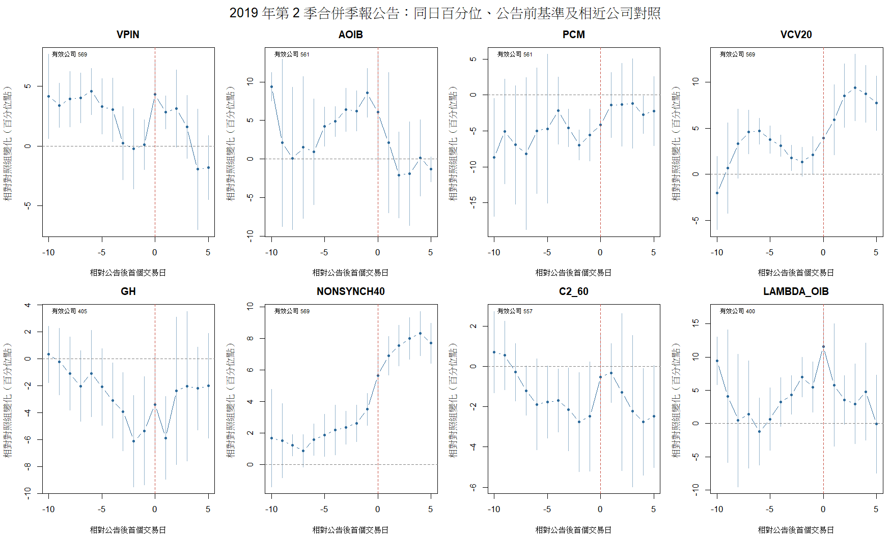

# HW3 第 6 題：2019 年第 2 季合併季報公告事件研究

## 事件與可用樣本

事件取自 [TEJ「上市合併季報公告日－2Q」原始檔](TEJ20261031024209/20261031024214.txt)。這個檔案的「證券代碼」欄其實是事件類別 `R1TSE2`；股票代碼須由「公司及名稱」欄擷取。「年」欄在全檔固定顯示 2026，不能當作事件發生年；本研究依「事件日／公告日」篩選 2019 年資料。兩個日期在本次入選紀錄相同，沒有資料可辨識盤前或盤後發布。

原檔 17,496 列，2019 年第 2 季公告有 912 列；與本次 HW3 的 600 檔樣本相交、去除重複公司日期後，有 **569 家、22 個公告日期**。其餘 31 檔在此「上市合併季報－2Q」檔無對應公告，不替它們推測日期。[事件名單與對應交易日](results/q6_events_mapped.csv)可逐檔核對。主分析將 **公告日之後的第一個交易日** 設為 \(t=0\)，故 22 個公告日期對應 20 個事件交易日；另用「公告當日若有交易，否則次一交易日」重算，檢查時間不明造成的一日偏移。文獻也指出，只有日期而沒有發布時刻時，盤前或盤後公告會造成事件交易日的一日誤差。[Time-Varying Arrival Rates of Informed and Uninformed Trades](https://academic.oup.com/jfec/article/6/2/171/874320)。

**事前預期。** 若私人財報資訊在公告前被利用，資訊性交易代理可能在公告前上升；公開揭露後，資訊落差可能縮小，代理隨之回落。但公開消息也可帶動交易、波動及投資人對消息的不同解讀，所以並非每個代理都應同方向變動。這裡不把代理值當作真實知情交易機率。前述文獻以動態 PIN 觀察到公告前後短窗變化；本研究的台股代理及集合競價資料並非其模型估計量。

## 設計與第 2 題因素控制

以公司交易日計事件時間，基準期為 \(t=-30\) 至 \(t=-11\)，逐日圖呈現 \(t=-10\) 至 \(t=+5\)；主要比較公告前 \([-5,-1]\) 與公告後 \([0,+5]\) 的平均。每項指標先在每個交易日的 600 檔樣本中，以**當日可估的公司**轉為百分位排名，使不同單位可並列，且減少全市場當日水準變化的影響。圖表及下表的單位是**百分位點變化，不是 PIN 的百分比**。

每個事件公司選五檔同日對照公司：對照公司不得在該事件日的 \([-40,+5]\) 交易日內有本檔記錄的第 2 季公告；以 \(t=-40\) 至 \(t=-11\) 的日報酬波動、平均週轉率、平均 Amihud 非流動性，以及 \(t=-11\) 的市值對數做最近鄰配對。這四項均來自**本次 HW3** 日資料，沒有沿用上次作業的規模分層。對每個指標 \(m\)，計算

\[
D_{i,\tau}^{(m)}
=100\left[
\left(R_{i,t_i+\tau}^{(m)}-\bar R_{i,B}^{(m)}\right)
-\frac{1}{|C_{i,\tau}^{(m)}|}\sum_{c\in C_{i,\tau}^{(m)}}
\left(R_{c,t_i+\tau}^{(m)}-\bar R_{c,B}^{(m)}\right)
\right],
\]

其中 \(R\) 是當日公司百分位（0 到 1）、\(B=[-30,-11]\)、\(C_{i,\tau}^{(m)}\) 是五檔配對公司中該日及基準期都有有效估計者，至少須有三檔；兩個比較窗口各至少需 3 個有效交易日。信賴區間及 \(p\) 值按 **20 個事件交易日分組** 計算，以反映大量公司集中在相同發布日；C2_60 可估的事件交易日為 16 個。這些是探索性推論，未處理全部可能的同期公司事件與跨指標多重檢定。

主配對的可用對照池每事件至少 31 檔、中位數 47 檔。配對後四項變數的平均絕對標準化差距約 **0.40–0.61 個標準差**，平衡仍不理想。因此另對每個事件日的未公告對照池，以同樣四項**公告前**變數迴歸預測正常的窗口變化，再計算事件公司超出預測的變化；這是預先列出的控制變數敏感度檢查，不用公告後的交易或波動當控制值。[配對明細](results/q6_matched_controls.csv)、[迴歸調整結果](results/q6_regression_adjusted_tests.csv)。

## 八項事件路徑與結果

VPIN、AOIB、PCM、GH 式成本和成交價版 \(|\lambda\times OIB|\) 使用第 3 題已估的**逐日**值。全期 VCV、\(1-R^2\) 與 C₂ 原本每家公司只有一個值，不能直接畫事件路徑；第 6 題另明示以**過去 20 日成交值比重 CV、過去 40 日日報酬市場模型 \(1-R^2\)、過去 60 日 Llorente 原始週轉率版 C₂** 作每日滾動版本，圖中分別標為 `VCV20`、`NONSYNCH40`、`C2_60`。這三者與第 3 題的全期估計**不是同一估計量**；NONSYNCH40 也**不是原文 AIV**，GH 也**不是原文 QID residual**。財報公告檔現在提供 569 家的事件日期，但並未自動把第 3、5 題的代理值改稱原始 AIV。

下表主欄為**配對對照後、相對基準期的平均百分位點**；括號為有效公司數。\(\Delta\) 是同一公司公告後減公告前的變化。右欄是另以四項公告前因素迴歸調整後的公告前效果。完整的逐日係數、95% 信賴區間與 \(p\) 值分別見 [事件路徑](results/q6_event_path.csv)、[配對窗口檢定](results/q6_window_tests.csv)及 [迴歸調整檢定](results/q6_regression_adjusted_tests.csv)。

| 指標 | 公告前 \([-5,-1]\) | 公告後 \([0,+5]\) | 後－前 \(\Delta\) | 迴歸調整後公告前 |
|---|---:|---:|---:|---:|
| VPIN | +1.32（568） | +1.28（569） | −0.02（568） | +1.93（568） |
| AOIB | **+5.95**（561） | +0.47（562） | **−5.48**（559） | **+7.75**（564） |
| PCM | −4.81（561） | −2.13（562） | +2.68（559） | −5.47（564） |
| VCV20 | +2.42（569） | +7.37（569） | +4.95（569） | +1.71（569） |
| GH 式成本 | −4.11（366） | −2.92（386） | +1.28（362） | −3.63（404） |
| NONSYNCH40 | +2.50（569） | +7.34（569） | +4.84（569） | **−1.81**（569） |
| C2_60 | −2.17（557） | −1.60（557） | +0.57（557） | −1.45（557） |
| 成交價版 \(|\lambda\times OIB|\) | +4.08（396） | +4.79（391） | +0.61（391） | +5.20（398） |

**是否符合預期？部分符合，但八項並不一致。** AOIB 公告前高於對照組 **5.95 百分位點**，公告後相對公告前下降 **5.48 點**；兩者按事件交易日分組的 \(p<0.001\)，且公告前迴歸調整後仍為 **+7.75 點**。這與公告前資訊失衡、公開後收斂的方向一致，但 AOIB 本身與非流動性強相關，不能據此證明有內線交易。成交價版 \(|\lambda\times OIB|\) 公告前亦高 **4.08 點**，迴歸調整後 **5.20 點**，但主設計的公告後降幅不明顯（後－前 **+0.61 點，\(p=0.45\)**）。

VPIN 公告前僅 **+1.32 點（\(p=0.23\)）**，公告後幾乎未下降。VCV20 在公告前 **+2.42**、公告後 **+7.37** 點，較像公告後交易或波動增加；NONSYNCH40 的公告前配對效果 **+2.50** 點，在迴歸調整後變成 **−1.81** 點，顯示其結論對控制方式敏感。PCM、GH 式成本與 C2_60 的公告前方向也不支持「所有代理在公告前一律升高」。主設計的 \(t=-1\) 可能已包含盤前或盤中公布後的交易，故另以公告當日對齊：[敏感度表](results/q6_window_tests.csv)中 AOIB 公告前仍為 **+4.58 點**、公告後減公告前為 **−2.66 點**；VPIN 公告前變為 **+2.47 點**，卻仍無穩健的公告後下降。

**解讀界限。** 此檔只有第 2 季合併季報的日期，沒有精確發布時刻、財報驚喜方向、分析師預期、機構持股或其他同期公告。公告後的高波動與高交易量可反映**公開資訊的反應**；公告前的異常亦可能來自預期、流動性或其他未觀察事件。20 個事件交易日集中、31 檔無公告日期、對照組平衡不完全，以及 GH／成交價版 \(|\lambda\times OIB|\) 的缺值，均限制外推與因果解釋。這些結果是以多種代理對財報事件做辨識力比較，**不是確證的知情交易機率或不法交易證據**。

